# Entity Relationship Diagram

## Purpose

This document defines the target Microsoft SQL Server entity relationship model for EHRS based on the current SRS and SDD. It is intended to guide schema design, migration planning, and backend implementation.

## Design Notes

- All timestamp fields should use a SQL Server datetime-compatible type.
- All identifier fields should use a stable primary key strategy such as `uniqueidentifier` or a controlled surrogate key.
- Foreign keys should be indexed where used in joins or filtering.
- Audit and workflow tables should preserve change history rather than overwrite critical state.

## Detailed ERD

```mermaid
erDiagram
    ROLE {
        uuid role_id PK
        string role_code UK
        string role_name
        string description
        datetime created_at
        datetime updated_at
    }

    APP_USER {
        uuid user_id PK
        string username UK
        string password_hash
        string first_name
        string last_name
        string email
        string status
        datetime last_login_at
        datetime created_at
        datetime updated_at
    }

    USER_ROLE {
        uuid user_role_id PK
        uuid user_id FK
        uuid role_id FK
        datetime created_at
    }

    PATIENT {
        uuid patient_id PK
        string medical_record_number UK
        string first_name
        string middle_name
        string last_name
        date date_of_birth
        string sex
        string phone_number
        string email
        string address_line_1
        string address_line_2
        string city
        string state
        string postal_code
        string emergency_contact_name
        string emergency_contact_phone
        string status
        datetime created_at
        datetime updated_at
    }

    DOCTOR {
        uuid doctor_id PK
        uuid user_id FK
        string employee_number UK
        string license_number UK
        string specialty
        string department
        string status
        datetime created_at
        datetime updated_at
    }

    NURSE {
        uuid nurse_id PK
        uuid user_id FK
        string employee_number UK
        string license_number UK
        string department
        string status
        datetime created_at
        datetime updated_at
    }

    VISIT {
        uuid visit_id PK
        uuid patient_id FK
        uuid assigned_doctor_id FK
        uuid assigned_nurse_id FK
        uuid created_by_user_id FK
        datetime visit_date
        string visit_type
        string current_status
        string visit_reason
        string symptoms
        string triage_notes
        string visit_summary
        datetime created_at
        datetime updated_at
    }

    VISIT_STATUS_HISTORY {
        uuid visit_status_history_id PK
        uuid visit_id FK
        string old_status
        string new_status
        uuid changed_by_user_id FK
        string change_reason
        datetime changed_at
    }

    DIAGNOSIS_REFERENCE {
        uuid diagnosis_reference_id PK
        string diagnosis_code UK
        string diagnosis_name
        string description
        string status
        datetime created_at
        datetime updated_at
    }

    VISIT_DIAGNOSIS {
        uuid visit_diagnosis_id PK
        uuid visit_id FK
        uuid diagnosis_reference_id FK
        uuid diagnosed_by_doctor_id FK
        string remarks
        boolean is_primary
        datetime created_at
    }

    ORDER_ITEM {
        uuid order_id PK
        uuid visit_id FK
        uuid patient_id FK
        uuid ordering_doctor_id FK
        string order_type
        string order_name
        string order_status
        string notes
        datetime ordered_at
        datetime updated_at
    }

    MEDICAL_RECORD_SECTION {
        uuid medical_record_section_id PK
        uuid patient_id FK
        uuid visit_id FK
        string section_type
        string section_title
        text section_data
        uuid recorded_by_user_id FK
        datetime recorded_at
        datetime updated_at
    }

    VISIT_VITAL {
        uuid visit_vital_id PK
        uuid visit_id FK
        uuid patient_id FK
        uuid recorded_by_nurse_id FK
        decimal temperature_c
        decimal pulse_bpm
        decimal systolic_bp
        decimal diastolic_bp
        decimal respiratory_rate
        decimal oxygen_saturation
        decimal height_cm
        decimal weight_kg
        datetime recorded_at
    }

    MEDICATION_REFERENCE {
        uuid medication_reference_id PK
        string medication_code UK
        string medication_name
        string dosage_form
        string strength
        string status
        datetime created_at
        datetime updated_at
    }

    VISIT_MEDICATION {
        uuid visit_medication_id PK
        uuid visit_id FK
        uuid patient_id FK
        uuid medication_reference_id FK
        uuid prescribed_by_doctor_id FK
        string dosage_instruction
        string frequency
        string duration
        string medication_status
        datetime prescribed_at
    }

    LAB_REFERENCE {
        uuid lab_reference_id PK
        string lab_code UK
        string lab_name
        string description
        string status
        datetime created_at
        datetime updated_at
    }

    VISIT_LAB_RESULT {
        uuid visit_lab_result_id PK
        uuid visit_id FK
        uuid patient_id FK
        uuid lab_reference_id FK
        uuid ordered_by_doctor_id FK
        string result_value
        string result_unit
        string reference_range
        string interpretation
        string lab_status
        datetime resulted_at
        datetime updated_at
    }

    IMAGING_REFERENCE {
        uuid imaging_reference_id PK
        string imaging_code UK
        string imaging_name
        string description
        string status
        datetime created_at
        datetime updated_at
    }

    VISIT_IMAGING_RESULT {
        uuid visit_imaging_result_id PK
        uuid visit_id FK
        uuid patient_id FK
        uuid imaging_reference_id FK
        uuid ordered_by_doctor_id FK
        string report_text
        string impression
        string imaging_status
        datetime resulted_at
        datetime updated_at
    }

    TREATMENT_ITEM {
        uuid treatment_item_id PK
        uuid visit_id FK
        uuid patient_id FK
        uuid performed_by_user_id FK
        string treatment_name
        string treatment_type
        int quantity
        decimal unit_cost
        decimal total_cost
        string notes
        datetime performed_at
    }

    CHECKOUT_RECORD {
        uuid checkout_id PK
        uuid visit_id FK
        uuid patient_id FK
        uuid finalized_by_user_id FK
        decimal subtotal_amount
        decimal tax_amount
        decimal discount_amount
        decimal total_amount
        string payment_status
        string payment_method
        datetime finalized_at
        datetime created_at
    }

    PAYMENT_TRANSACTION {
        uuid payment_transaction_id PK
        uuid checkout_id FK
        decimal transaction_amount
        string payment_method
        string transaction_reference
        string transaction_status
        datetime processed_at
        datetime created_at
    }

    AUDIT_LOG {
        uuid audit_log_id PK
        uuid user_id FK
        string entity_name
        uuid entity_id
        string action_type
        string old_value
        string new_value
        string source_ip
        datetime created_at
    }

    APP_USER ||--o{ USER_ROLE : assigned
    ROLE ||--o{ USER_ROLE : grants

    APP_USER ||--o| DOCTOR : may_be
    APP_USER ||--o| NURSE : may_be

    PATIENT ||--o{ VISIT : has
    DOCTOR ||--o{ VISIT : assigned_to
    NURSE ||--o{ VISIT : triages
    APP_USER ||--o{ VISIT : creates

    VISIT ||--o{ VISIT_STATUS_HISTORY : tracks
    APP_USER ||--o{ VISIT_STATUS_HISTORY : changes

    DIAGNOSIS_REFERENCE ||--o{ VISIT_DIAGNOSIS : referenced_by
    VISIT ||--o{ VISIT_DIAGNOSIS : includes
    DOCTOR ||--o{ VISIT_DIAGNOSIS : diagnoses

    VISIT ||--o{ ORDER_ITEM : generates
    PATIENT ||--o{ ORDER_ITEM : receives
    DOCTOR ||--o{ ORDER_ITEM : orders

    PATIENT ||--o{ MEDICAL_RECORD_SECTION : owns
    VISIT ||--o{ MEDICAL_RECORD_SECTION : records
    APP_USER ||--o{ MEDICAL_RECORD_SECTION : records

    VISIT ||--o{ VISIT_VITAL : contains
    PATIENT ||--o{ VISIT_VITAL : has
    NURSE ||--o{ VISIT_VITAL : records

    MEDICATION_REFERENCE ||--o{ VISIT_MEDICATION : referenced_by
    VISIT ||--o{ VISIT_MEDICATION : includes
    PATIENT ||--o{ VISIT_MEDICATION : receives
    DOCTOR ||--o{ VISIT_MEDICATION : prescribes

    LAB_REFERENCE ||--o{ VISIT_LAB_RESULT : referenced_by
    VISIT ||--o{ VISIT_LAB_RESULT : includes
    PATIENT ||--o{ VISIT_LAB_RESULT : has
    DOCTOR ||--o{ VISIT_LAB_RESULT : orders

    IMAGING_REFERENCE ||--o{ VISIT_IMAGING_RESULT : referenced_by
    VISIT ||--o{ VISIT_IMAGING_RESULT : includes
    PATIENT ||--o{ VISIT_IMAGING_RESULT : has
    DOCTOR ||--o{ VISIT_IMAGING_RESULT : orders

    VISIT ||--o{ TREATMENT_ITEM : results_in
    PATIENT ||--o{ TREATMENT_ITEM : receives
    APP_USER ||--o{ TREATMENT_ITEM : performs

    VISIT ||--o| CHECKOUT_RECORD : closes_with
    PATIENT ||--o{ CHECKOUT_RECORD : billed_for
    APP_USER ||--o{ CHECKOUT_RECORD : finalizes

    CHECKOUT_RECORD ||--o{ PAYMENT_TRANSACTION : paid_by

    APP_USER ||--o{ AUDIT_LOG : produces
```

## Entity Summaries

### Identity and Access

- `APP_USER`: system login identity for staff users.
- `ROLE`: role catalog such as doctor, nurse, intake, checkout, or administrator.
- `USER_ROLE`: many-to-many join table between users and roles.

### Clinical Actors

- `DOCTOR`: doctor-specific attributes linked to an application user.
- `NURSE`: nurse-specific attributes linked to an application user.

### Patient and Visit Core

- `PATIENT`: master patient demographic record.
- `VISIT`: central encounter record for each patient interaction.
- `VISIT_STATUS_HISTORY`: workflow history for each visit.

### Clinical Documentation

- `DIAGNOSIS_REFERENCE`: diagnosis master list or catalog.
- `VISIT_DIAGNOSIS`: diagnoses attached to a visit.
- `MEDICAL_RECORD_SECTION`: generalized section storage for demographics, diagnosis, treatment, imaging, and other chart content.
- `VISIT_VITAL`: structured vitals captured during a visit.

### Orders and Results

- `ORDER_ITEM`: operational order record for prescription, radiology, or lab orders.
- `MEDICATION_REFERENCE`: medication catalog.
- `VISIT_MEDICATION`: medication orders or administered medications linked to a visit.
- `LAB_REFERENCE`: lab test catalog.
- `VISIT_LAB_RESULT`: lab orders and results linked to a visit.
- `IMAGING_REFERENCE`: imaging catalog.
- `VISIT_IMAGING_RESULT`: imaging orders and results linked to a visit.

### Treatment and Billing

- `TREATMENT_ITEM`: billable or documented treatments performed during a visit.
- `CHECKOUT_RECORD`: billing summary and payment state for a visit.
- `PAYMENT_TRANSACTION`: individual payment attempts or completed payment records.

### Audit

- `AUDIT_LOG`: change and access audit trail for critical system operations.

## SQL Server Design Recommendations

### Primary Keys

- Prefer `uniqueidentifier` for distributed-safe IDs if IDs are generated by the backend.
- Alternatively use numeric surrogate keys if the implementation prioritizes compact indexing over globally unique identifiers.

### Foreign Keys

Recommended foreign keys include:

- `VISIT.patient_id -> PATIENT.patient_id`
- `VISIT.assigned_doctor_id -> DOCTOR.doctor_id`
- `VISIT.assigned_nurse_id -> NURSE.nurse_id`
- `ORDER_ITEM.visit_id -> VISIT.visit_id`
- `VISIT_DIAGNOSIS.visit_id -> VISIT.visit_id`
- `CHECKOUT_RECORD.visit_id -> VISIT.visit_id`

### Indexing

Recommended nonclustered indexes:

- `PATIENT(medical_record_number)`
- `VISIT(patient_id, visit_date DESC)`
- `VISIT(current_status, visit_date DESC)`
- `ORDER_ITEM(visit_id, order_type, order_status)`
- `CHECKOUT_RECORD(visit_id, payment_status)`
- `VISIT_STATUS_HISTORY(visit_id, changed_at DESC)`

### Normalization Guidance

- Keep staff identity in `APP_USER` and staff role tables to avoid duplication.
- Use reference tables for diagnosis, medication, lab, and imaging catalogs.
- Store transactional clinical records in visit-linked tables.
- Use generalized `MEDICAL_RECORD_SECTION` only where a structured subtype table is not yet justified.

## Suggested Implementation Order

1. Identity and access tables
2. Patient, doctor, nurse master tables
3. Visit and visit status history
4. Diagnosis and order tables
5. Vitals, medications, labs, imaging, and treatments
6. Checkout and payment tables
7. Audit logging tables
