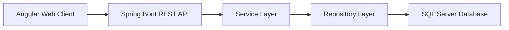
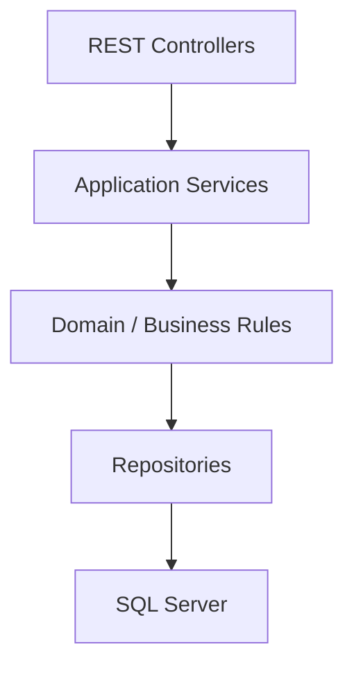
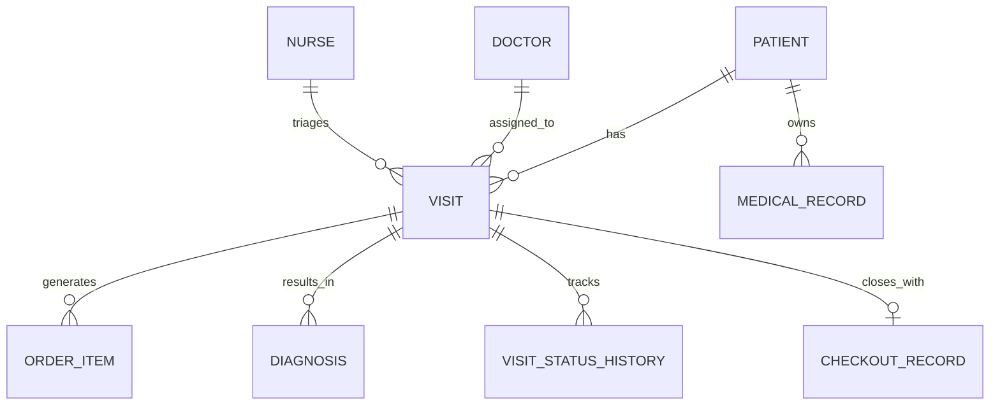
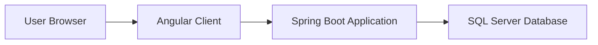

# Software Design Description

## Project

Electronic Health Record System (EHRS)

## Purpose

This Software Design Description (SDD) defines the intended software design for EHRS based on the current Angular codebase and the target architecture established in the SRS. It describes the system structure, major components, interfaces, data design, and deployment design for an Angular front-end, Spring Boot backend, and SQL Server database solution.

## Design Goals

The design shall support:

- Modular clinical workflow screens in the web client
- A centralized REST API backend
- Persistent relational storage for visit-centric healthcare workflows
- Separation of presentation, business logic, and persistence concerns
- Environment-based configuration across front-end and backend deployments

## Architectural Overview

EHRS uses a three-tier architecture:

1. Presentation tier: Angular single-page application
2. Application tier: Spring Boot REST API
3. Data tier: Microsoft SQL Server database

### High-Level Architecture

## System Context

### Front-End Context

The Angular application is responsible for:

- Rendering the user interface
- Handling client-side routing
- Collecting form input
- Calling backend APIs
- Rendering returned data in tables, forms, and detail views

### Back-End Context

The Spring Boot backend is responsible for:

- Exposing REST endpoints
- Validating requests
- Applying workflow business rules
- Coordinating persistence
- Returning structured JSON responses
- Handling errors consistently

### Database Context

SQL Server is responsible for:

- Persisting operational and clinical data
- Enforcing relationships among core entities
- Supporting queue, visit, and patient lookups
- Maintaining auditable records

## Front-End Design

### Front-End Technology Stack

- Angular application
- Angular Router
- Angular Forms and Reactive Forms
- Angular HttpClient
- Angular Material UI components

### Front-End Module Structure

The current Angular application is organized primarily within a single root module and route-driven feature components.

#### Root Module

The root module initializes:

- Browser support
- Routing
- Forms
- HTTP client support
- Angular Material components

#### Routing Design

The root router redirects `/` to `/login`.

The `/home` route acts as the main application shell and hosts child routes for feature screens.

Implemented route areas include:

- Login
- Home
- Medical record sections
- Visitation queue
- Visitation record creation
- Checkout
- Diagnosis
- Order entry
- Doctor and nurse landing or overview pages

### Front-End View Composition

#### App Component

The app root contains a single router outlet and delegates all page rendering to routed components.

#### Home Component

The Home component is the authenticated shell and contains:

- Header component
- Left-side drawer
- Menu component
- Nested router outlet for feature views

#### Header Component

The header provides top-of-screen branding and utility actions.

#### Menu Component

The menu organizes navigation options using expansion panels. It groups feature links into sections for:

- Visitation and medical views
- Medical record subsections
- Queue and checkout operations

### Front-End Feature Components

#### Login

The Login component captures username and password input. In the current codebase it is a UI-only component and does not yet integrate with authentication services.

#### Visitation Queue

The queue component renders queue data in a sortable Angular Material table and allows:

- Text filtering
- Status filtering
- Row selection and navigation

#### Visitation Record

The visitation record component collects visit creation data. It uses:

- Autocomplete for patient selection
- Template-driven or bound form fields
- A route resolver to preload patient directory data

#### Medical Record Views

The application defines separate components for:

- Demographics
- Vitals
- Medications
- Labs
- Diagnosis
- Treatment
- Imaging

These components form the read-oriented medical record section of the UI.

#### Diagnosis and Ordering

The doctor diagnosis component is the central workflow hub for:

- Viewing diagnosis data
- Entering remarks
- Submitting visit summary updates
- Navigating to order-entry screens

Order-entry components exist for:

- Prescription
- Radiology
- Lab test

#### Checkout

The checkout-related views display patient checkout data and treatment costs. The current implementation includes placeholder billing content but the design assumes a future backend-driven checkout flow.

### Front-End Service Design

The Angular client uses thin HTTP services to isolate API calls from components.

#### People Service

Responsible for:

- Fetching patients
- Fetching doctors

#### Visit Service

Responsible for:

- Submitting new visit records

#### Visitation Queue Service

Responsible for:

- Retrieving the full queue
- Retrieving filtered queue views by status

#### Consultation Service

Responsible for:

- Diagnosis lookup
- Visitation history retrieval
- Medical record retrieval
- Doctor and nurse identifier retrieval
- Order submission
- Visit summary updates

### Front-End Design Constraints

The current front-end shows several prototype characteristics:

- Some clinical identifiers are hard-coded in components
- Some flows depend on separate API base URLs
- Some data views are placeholders or incomplete

The target design shall eliminate these issues by:

- Using authenticated session context
- Using environment-driven API configuration
- Moving workflow state ownership to the backend

## Back-End Design

### Back-End Technology Stack

The target backend shall use:

- Spring Boot
- Spring Web for REST APIs
- Spring Data JPA or equivalent persistence abstraction
- SQL Server JDBC driver
- Validation framework for request validation
- Database migration tooling such as Flyway or Liquibase

### Layered Design

The backend shall follow a layered architecture:

#### Controller Layer

Responsibilities:

- Map HTTP routes to application use cases
- Parse path variables, query parameters, and request bodies
- Trigger validation
- Return HTTP responses and status codes

Proposed controller groups:

- `AuthController`
- `PeopleController`
- `VisitController`
- `QueueController`
- `MedicalRecordController`
- `ConsultationController`
- `OrderController`
- `CheckoutController`

#### Service Layer

Responsibilities:

- Apply workflow rules
- Coordinate multiple repositories
- Enforce state transitions
- Build DTOs for the API layer

Proposed service groups:

- `AuthenticationService`
- `PeopleService`
- `VisitService`
- `QueueService`
- `MedicalRecordService`
- `ConsultationService`
- `OrderService`
- `CheckoutService`

#### Repository Layer

Responsibilities:

- Read and write persisted entities
- Execute database queries
- Support lookup by IDs, status, and relationships

Proposed repository groups:

- `PatientRepository`
- `DoctorRepository`
- `NurseRepository`
- `VisitRepository`
- `VisitStatusHistoryRepository`
- `DiagnosisRepository`
- `OrderRepository`
- `MedicalRecordRepository`
- `BillingRepository`

### API Design

The target API should use a versioned URL prefix:

- `/api/v1`

#### Proposed Resource Groups

- `/api/v1/auth`
- `/api/v1/people`
- `/api/v1/visits`
- `/api/v1/queue`
- `/api/v1/medical-records`
- `/api/v1/consultations`
- `/api/v1/orders`
- `/api/v1/checkout`

#### API Interaction Principles

The backend shall:

- Use JSON request and response bodies
- Return stable identifiers for persisted resources
- Return validation errors in structured form
- Return domain-specific status codes and messages where appropriate

#### Error Response Design

The backend should return a consistent error structure containing:

- Timestamp
- HTTP status
- Error code
- Human-readable message
- Field validation details when applicable
- Request path

## Data Design

### Core Domain Model

The target backend and database design are centered on the patient visit.

### Logical Entities

#### Patient

Stores demographic identity and lookup information.

Suggested attributes:

- `patient_id`
- `first_name`
- `last_name`
- `date_of_birth`
- `display_name`
- `created_at`
- `updated_at`

#### Doctor

Stores doctor identity and professional information.

Suggested attributes:

- `doctor_id`
- `first_name`
- `last_name`
- `employee_number`
- `specialty`
- `created_at`
- `updated_at`

#### Nurse

Stores nurse identity and operational assignment information.

Suggested attributes:

- `nurse_id`
- `first_name`
- `last_name`
- `employee_number`
- `created_at`
- `updated_at`

#### Visit

Represents a patient encounter and serves as the central transactional record.

Suggested attributes:

- `visit_id`
- `patient_id`
- `doctor_id`
- `nurse_id`
- `visit_date`
- `status`
- `visit_reason`
- `symptoms`
- `visit_summary`
- `created_by`
- `created_at`
- `updated_at`

#### Visit Status History

Tracks changes in visit workflow status over time.

Suggested attributes:

- `visit_status_history_id`
- `visit_id`
- `old_status`
- `new_status`
- `changed_by`
- `changed_at`

#### Diagnosis

Stores diagnostic conclusions and related notes.

Suggested attributes:

- `diagnosis_id`
- `visit_id`
- `diagnosis_code`
- `diagnosis_name`
- `remarks`
- `created_by`
- `created_at`

#### Order Item

Stores prescription, radiology, or lab orders.

Suggested attributes:

- `order_id`
- `visit_id`
- `patient_id`
- `clinician_id`
- `order_type`
- `order_name`
- `status`
- `created_at`

#### Medical Record

Stores or projects the patient’s medical record sections.

Suggested attributes:

- `medical_record_id`
- `patient_id`
- `section_type`
- `section_data`
- `recorded_at`
- `recorded_by`

#### Checkout Record

Stores patient checkout and payment-related information.

Suggested attributes:

- `checkout_id`
- `visit_id`
- `total_amount`
- `payment_status`
- `finalized_at`
- `finalized_by`

### Physical Database Considerations

SQL Server design should include:

- Primary keys on all core entities
- Foreign keys between patient, visit, order, diagnosis, and checkout tables
- Indexes on patient ID, visit ID, clinician ID, and visit status
- Audit timestamps on mutable transactional tables
- Migration scripts for reproducible schema setup

## Interface Design

### Angular to Spring Boot Interface

The Angular front-end should use one environment-configured API base URL.

The front-end shall call backend endpoints through service classes rather than embedding endpoint URLs in components.

Request payloads should be represented through typed DTOs in the front-end where possible.

### Spring Boot to SQL Server Interface

The backend should use ORM-managed entities or equivalent mapped persistence models.

Database transactions should be managed in the service layer for operations that modify multiple related records.

### External Configuration

Environment-specific values shall be externalized, including:

- Front-end API base URL
- Backend server port
- SQL Server host
- SQL Server database name
- SQL Server username and password
- CORS origins
- Authentication secrets or token configuration

## Security Design

### Authentication

The target design should support authenticated users through:

- Session-based authentication, or
- Token-based authentication such as JWT

### Authorization

Role-based access control should be supported for:

- Doctor
- Nurse
- Intake staff
- Checkout staff
- Administrator

### Data Protection

The design should protect sensitive data by:

- Using HTTPS for client-backend communication
- Avoiding hard-coded secrets
- Restricting database permissions to application needs
- Auditing access and update events where required

## Concurrency and Transaction Design

The system shall preserve consistency for visit-centric operations.

Examples of transactional operations include:

- Creating a visit
- Updating visit summary and status
- Creating an order tied to a visit
- Finalizing checkout

If any step in a transactional operation fails, the backend should roll back partial writes.

## Logging and Error Handling Design

### Logging

The backend should log:

- Request failures
- Validation failures
- Persistence failures
- State-transition events for clinical workflows

Sensitive clinical or credential data should not be written to logs in plaintext.

### Error Handling

The front-end should show user-friendly messages for:

- Validation errors
- Network failures
- Backend business-rule failures

The backend should use centralized exception handling to convert exceptions into predictable API responses.

## Deployment Design

### Development Deployment

Development deployment may consist of:

- Angular dev server for the web client
- Spring Boot application running locally
- Local or shared SQL Server instance

### Production Deployment

Production deployment should consist of:

- Static hosting or web server delivery of the Angular build
- Deployed Spring Boot service
- Managed or dedicated SQL Server database

### Deployment Diagram

## Traceability to Current Implementation

The current repository fully implements the Angular front-end structure but does not yet include the Spring Boot backend or SQL Server schema.

The current front-end design elements already present include:

- Angular route-based navigation
- Angular Material-driven screens
- Thin HTTP service abstractions
- Patient, visit, and queue-oriented client models

The target backend and database design in this document are intended to replace the current split API arrangement and prototype data assumptions with a unified production architecture.

## Known Design Risks

- Existing front-end flows rely on hard-coded identifiers in several places
- Current API usage is split across multiple base URLs
- Some UI screens are placeholder implementations rather than full workflow implementations
- Checkout and authentication flows are not yet backed by production-grade services

## Future Design Evolution

Likely future design improvements include:

- Shared API contracts between Angular and Spring Boot
- DTO versioning and schema validation
- Better route guards and authenticated session management
- Stronger domain modeling for medical record sections
- Reporting and audit modules
- Background processing for notifications or workflow events
